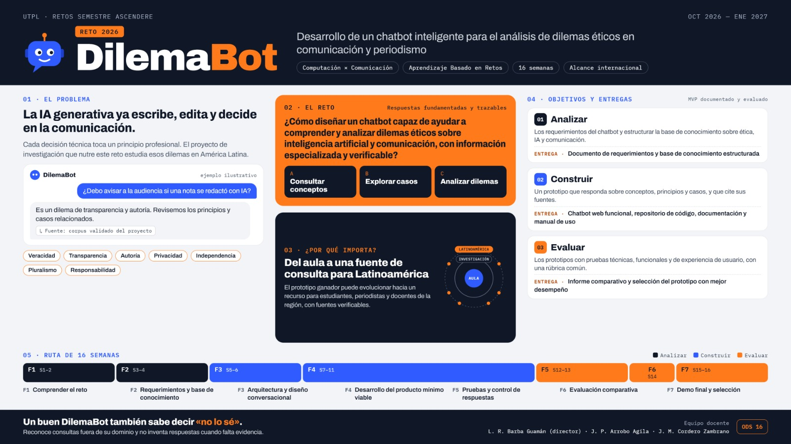

# 🤖 DilemaBot — Reto 2026

> **UTPL · Retos Semestre Ascendere** · Octubre 2026 – Enero 2027

**Desarrollo de un chatbot inteligente para el análisis de dilemas éticos en comunicación y periodismo.**

`Computación × Comunicación` · `Aprendizaje Basado en Retos` · `16 semanas` · `Alcance internacional` · `ODS 16`



---

## 01 · El problema

### La IA generativa ya escribe, edita y decide en la comunicación

Cada decisión técnica toca un principio profesional. El proyecto de investigación que nutre este reto estudia esos dilemas en América Latina.

**Principios en juego:**

`Veracidad` · `Transparencia` · `Autoría` · `Privacidad` · `Independencia` · `Pluralismo` · `Responsabilidad`

**Ejemplo de interacción** *(ilustrativo)*:

> 🧑 **Usuario:** ¿Debo avisar a la audiencia si una nota se redactó con IA?
>
> 🤖 **DilemaBot:** Es un dilema de transparencia y autoría. Revisemos los principios y casos relacionados.
>
> ↳ *Fuente: corpus validado del proyecto*

---

## 02 · El reto

*Respuestas fundamentadas y trazables*

> **¿Cómo diseñar un chatbot capaz de ayudar a comprender y analizar dilemas éticos sobre inteligencia artificial y comunicación, con información especializada y verificable?**

El chatbot debe permitir tres tipos de uso:

| | Capacidad | Descripción |
|---|---|---|
| **A** | **Consultar conceptos** | Preguntar por principios éticos y conceptos del dominio. |
| **B** | **Explorar casos** | Recuperar casos de dilemas éticos relacionados con la consulta. |
| **C** | **Analizar dilemas** | Analizar una situación dilemática con respuestas fundamentadas en el corpus. |

---

## 03 · ¿Por qué importa?

### Del aula a una fuente de consulta para Latinoamérica

El prototipo ganador puede evolucionar hacia un recurso para estudiantes, periodistas y docentes de la región: ética de la comunicación explicada con fuentes verificables, no con respuestas inventadas.

```
Aula  ──►  Investigación  ──►  Latinoamérica
```

---

## 04 · Objetivos y entregas

*Un producto mínimo viable, documentado y evaluado.*

| # | Objetivo | Qué se hace | Entrega |
|---|---|---|---|
| **01** | **Analizar** | Los requerimientos del chatbot y estructurar la base de conocimiento sobre ética, IA y comunicación. | Documento de requerimientos y base de conocimiento estructurada |
| **02** | **Construir** | Un prototipo que responda sobre conceptos, principios y casos, y que cite sus fuentes. | Chatbot web funcional, repositorio de código, documentación y manual de uso |
| **03** | **Evaluar** | Los prototipos con pruebas técnicas, funcionales y de experiencia de usuario, con una rúbrica común. | Informe comparativo y selección del prototipo con mejor desempeño |

---

## 05 · Ruta de 16 semanas

⬛ Analizar · 🟦 Construir · 🟧 Evaluar

| Fase | Semanas | Etapa | Actividad |
|---|---|---|---|
| **F1** | S1–2 | ⬛ Analizar | Comprender el reto |
| **F2** | S3–4 | ⬛ Analizar | Requerimientos y base de conocimiento |
| **F3** | S5–6 | 🟦 Construir | Arquitectura y diseño conversacional |
| **F4** | S7–11 | 🟦 Construir | Desarrollo del producto mínimo viable |
| **F5** | S12–13 | 🟧 Evaluar | Pruebas y control de respuestas |
| **F6** | S14 | 🟧 Evaluar | Evaluación comparativa |
| **F7** | S15–16 | 🟧 Evaluar | Demo final y selección |

```
Semana   1  2  3  4  5  6  7  8  9  10 11 12 13 14 15 16
F1       ██ ██
F2             ██ ██
F3                   ██ ██
F4                         ██ ██ ██ ██ ██
F5                                        ██ ██
F6                                              ██
F7                                                 ██ ██
```

---

## Un buen DilemaBot también sabe decir «no lo sé»

Reconoce consultas fuera de su dominio y no inventa respuestas cuando falta evidencia.

---

## Puesta en marcha (prototipo)

Requisitos: Python 3.12 o superior y Docker (para Ollama, que genera las respuestas).

```bash
python3 -m venv .venv
.venv/bin/pip install -e ".[dev]"   # instala el paquete dilemabot y sus comandos
cp .env.example .env                # modelo, hilos de CPU, umbrales…

docker compose up -d                                # Ollama en http://localhost:11434
docker compose exec ollama ollama pull qwen2.5:7b   # modelo de respuestas (OLLAMA_MODEL)
docker compose exec ollama ollama pull bge-m3       # embeddings para la búsqueda por significado

.venv/bin/dilemabot-ingest                          # segmenta el corpus → knowledge/indice/
.venv/bin/uvicorn dilemabot.main:app --port 8000
```

Abrir <http://localhost:8000>. Sin Ollama la aplicación arranca igual, pero el chat muestra el error del modelo; `dilemabot-ingest --sin-vectores` genera un índice solo con búsqueda por palabras clave (BM25).

| Comando | Para qué |
|---|---|
| `.venv/bin/python -m pytest` | Pruebas automáticas |
| `.venv/bin/dilemabot-calibrar` | Mide los puntajes de búsqueda y valida los umbrales de «no lo sé» |

## Estructura del repositorio

La carpeta de cada capa corresponde a un bloque de la [arquitectura](docs/arquitectura.md):

```
ChatBot-IA/
├── backend/dilemabot/       Servidor Python (FastAPI)
│   ├── main.py              Punto de entrada: arma la app web
│   ├── api/                 Capa HTTP: endpoints /api/chat (streaming), /api/salud, /api/fuentes
│   ├── chat/                Orquestación: flujo de respuesta, prompts y control (evidencia, citas)
│   ├── retrieval/           Búsqueda híbrida BM25 + vectores sobre el índice
│   ├── ingestion/           Segmentación del corpus por artículo y generación del índice
│   ├── llm/                 Proveedores de modelos intercambiables (Ollama; Claude en S11)
│   ├── evaluation/          Calibración y evaluación de respuestas
│   └── core/                Configuración (.env)
├── backend/tests/           Pruebas con pytest
├── frontend/                Interfaz web (HTML + CSS + JS sin dependencias)
├── knowledge/               Base de conocimiento
│   ├── fuentes.yaml         Registro de fuentes: país, enlace, vigencia, motivo de inclusión
│   ├── documentos/          Corpus en Markdown (lo que se ingiere)
│   ├── pdf/                 Originales en PDF (se enlazan en las citas)
│   └── indice/              Generado por dilemabot-ingest (no se versiona)
├── docs/                    Documentación del proyecto
│   ├── arquitectura.md      Capas, flujo de una respuesta y decisiones
│   ├── avance_implementacion.md
│   ├── planificacion/       Plan de desarrollo y preguntas por fase
│   ├── reto/                Propuesta del reto e infografías
│   └── diseno/              Sistema de diseño y prototipo de la landing
├── docker-compose.yml       Ollama en Docker
└── pyproject.toml           Dependencias y comandos del paquete
```

Estado y pendientes: [Avance de implementación](docs/avance_implementacion.md).

---

## Equipo docente

- Luis Rodrigo Barba Guamán *(director)*
- Juan Pablo Arrobo Agila
- Jorge Marcos Cordero Zambrano

---

## Documentación del repositorio

- [Arquitectura del sistema](docs/arquitectura.md)
- [Plan de desarrollo](docs/planificacion/Plan_Desarrollo_DilemaBot.md) · [Preguntas de planificación](docs/planificacion/Planificacion_DilemaBot.md)
- [Propuesta del reto (formulario completo)](docs/reto/Propuesta_Reto_DilemaBot_2026.md)
- [Resumen de documentos del corpus](knowledge/resumen_documentos.md)
- Corpus normativo en Markdown: [`knowledge/documentos/`](knowledge/documentos/) · Originales en PDF: [`knowledge/pdf/`](knowledge/pdf/)
- Diseño: [`docs/diseno/DESIGN.md`](docs/diseno/DESIGN.md)
- Infografías: [horizontal](docs/reto/img/dilema-bot.jpeg) · [vertical](docs/reto/img/dilema-bot1.jpeg)
