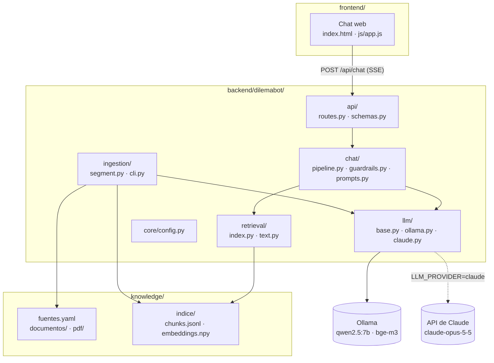
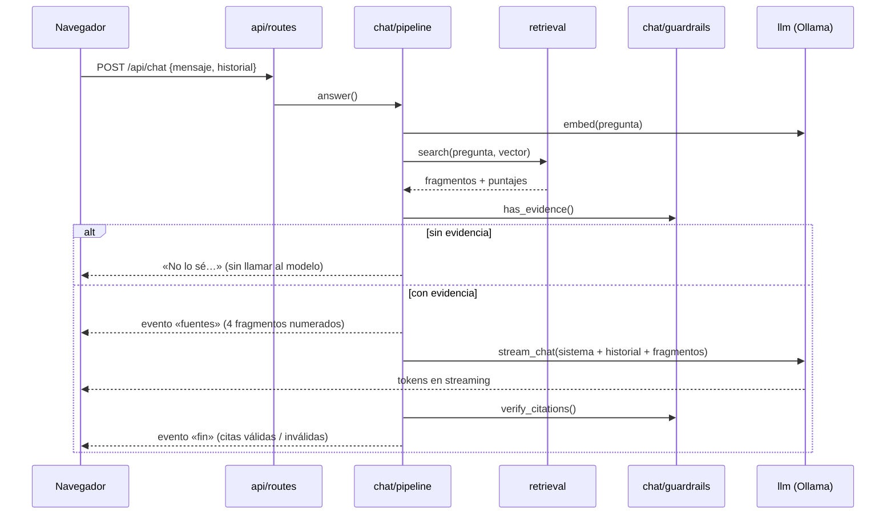

# Arquitectura — DilemaBot

> Versión 0.1 · 13-nov-2026 · Complementa el [Plan de desarrollo](planificacion/Plan_Desarrollo_DilemaBot.md) (sección 5)

DilemaBot es una aplicación **RAG** (*retrieval-augmented generation*): antes de responder busca en un corpus validado los fragmentos que respaldan la respuesta, y el modelo de lenguaje solo redacta a partir de ellos, citándolos. Si no hay evidencia, responde «no lo sé» sin consultar al modelo.

## Capas



| Capa | Carpeta | Responsabilidad | Depende de |
|---|---|---|---|
| Interfaz | `frontend/` | Chat, streaming, citas clicables, fuentes con enlace | API |
| API | `backend/dilemabot/api/` | Endpoints HTTP, validación de entradas, Server-Sent Events | chat, retrieval |
| Conversación | `backend/dilemabot/chat/` | Orquesta el flujo de una respuesta; control de evidencia y citas | retrieval, llm |
| Recuperación | `backend/dilemabot/retrieval/` | Búsqueda híbrida BM25 + vectores, refuerzos, límite por fuente | índice |
| Modelos | `backend/dilemabot/llm/` | Interfaz `LLMProvider`; implementaciones Ollama y Claude | servicio externo |
| Ingesta | `backend/dilemabot/ingestion/` | Segmenta el corpus por artículo y genera el índice | llm (embeddings) |
| Evaluación | `backend/dilemabot/evaluation/` | Calibración de umbrales; luego, pruebas de respuestas (S12) | chat, retrieval, llm |
| Configuración | `backend/dilemabot/core/` | Rutas y parámetros desde `.env` | — |
| Conocimiento | `knowledge/` | Corpus, registro de fuentes e índice generado | — |

Reglas de dependencia: las capas solo importan hacia abajo en la tabla (la API nunca llama directamente a Ollama, la recuperación no sabe qué modelo se usa). Por eso cambiar Ollama por Claude solo requiere un archivo nuevo en `llm/`.

## Flujo de una respuesta



1. **Saludos y agradecimientos** se responden con texto fijo, sin búsqueda.
2. **Búsqueda híbrida:** BM25 sobre palabras y pares de palabras + coseno sobre embeddings `bge-m3`, fusionados con RRF. Se refuerzan la fuente y el artículo nombrados («art. 43 de la Constitución»). Máximo 2 fragmentos por fuente y 4 en total.
3. **Preguntas de seguimiento** («¿y eso?») se vuelven a buscar junto a la pregunta anterior solo si la pregunta sola no tiene evidencia.
4. **Umbral de evidencia:** coseno ≥ 0,55, o BM25 ≥ 7,0 y coseno ≥ 0,45. Calibrado con `dilemabot-calibrar`.
5. **Generación:** el prompt de sistema obliga a usar solo los fragmentos, citar `[n]`, indicar el país y avisar la vigencia.
6. **Verificación:** las citas a fragmentos inexistentes se eliminan en la interfaz y se avisa; una respuesta sin citas muestra una advertencia.

## Base de conocimiento

```
knowledge/
├── fuentes.yaml        id, título, país, tipo, archivo, pdf, url, vigencia, nota_vigencia, motivo_inclusion, alias
├── documentos/<id>.md  corpus que se ingiere
├── pdf/<id>.pdf        original enlazado en cada cita
└── indice/             chunks.jsonl (1.172 fragmentos) · embeddings.npy · meta.json
```

Agregar una fuente = poner `documentos/<id>.md` (y su PDF), registrar la entrada en `fuentes.yaml` y ejecutar `dilemabot-ingest`. No se toca código.

## Proveedores de modelos

`LLM_PROVIDER` en `.env` elige quién redacta las respuestas. Los embeddings de la búsqueda siempre los calcula Ollama (`bge-m3`), porque la API de Claude no ofrece embeddings; así el índice y los umbrales calibrados sirven para ambos.

| | `ollama` (por defecto) | `claude` |
|---|---|---|
| Dónde corre | Local (Docker), sin costo | API de Anthropic, pago por uso |
| Modelo | `OLLAMA_MODEL` (`qwen2.5:7b`) | `CLAUDE_MODEL` (`claude-opus-5-5`) |
| Velocidad medida | ~40 s al primer token en CPU | Segundos (depende de la red) |
| Privacidad | Nada sale del equipo | La pregunta y los fragmentos se envían a Anthropic |
| Configuración | `OLLAMA_NUM_THREAD`, `LLM_NUM_CTX` | `ANTHROPIC_API_KEY`, `CLAUDE_EFFORT` (`low`/`medium`/`high`) |

Con Claude, si un filtro de seguridad declina una consulta, la API la reintenta automáticamente en otro modelo (*server-side fallbacks*); si todos declinan, el chat muestra «Claude declinó responder esta consulta».

## Decisiones

| Decisión | Motivo |
|---|---|
| FastAPI + SSE | Streaming simple; el usuario ve la respuesta mientras se genera |
| Proveedor LLM tras una interfaz | Ollama local hoy; Claude u otra API sin cambiar la lógica |
| Embeddings en NumPy (no ChromaDB) | ~1.200 fragmentos: producto matricial < 1 ms, una dependencia menos |
| Segmentación por artículo | Cada cita apunta a un artículo concreto |
| Frontend sin framework | Reutiliza el diseño de `docs/diseno/`; nada que compilar |
| Ollama en Docker | Instalación igual en todos los equipos del grupo |
| Privacidad | El servidor registra solo métricas, nunca el texto de las preguntas; la conversación vive en el navegador |
